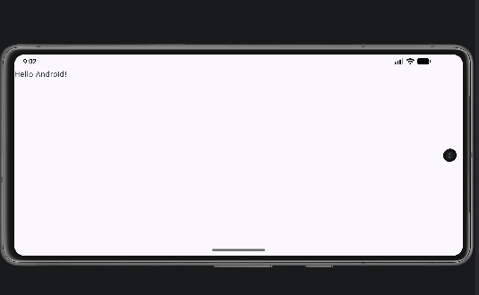
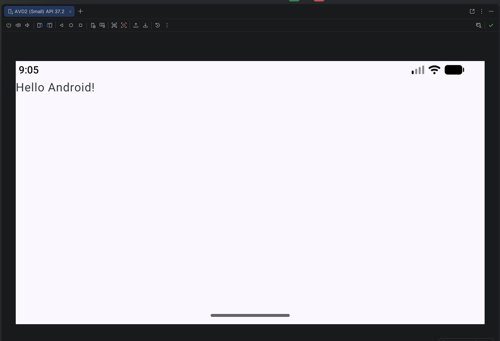
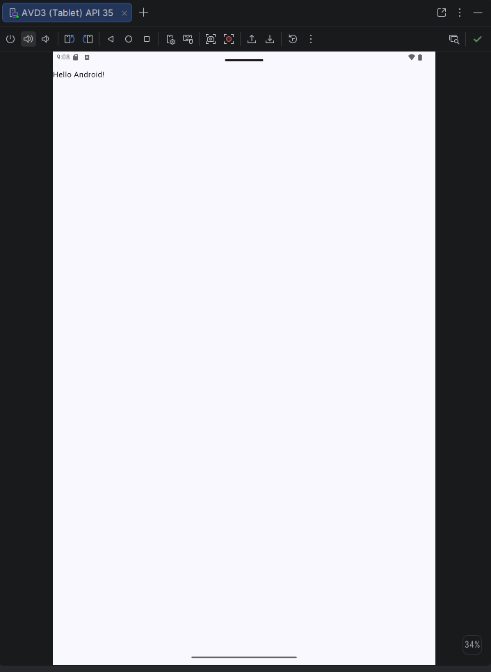

### Dispositivo AVD 1 (API 37)

La aplicación funciona de forma fluída y se ve todo bien, aunque pequeño,
tanto en vertical como en horizontal; sin cortes.

### Dispositivo AVD 2 (Small - API 37)

Al tener una resolución y densidad menores, el texto y otros
componentes ocupan un área mayor en la pantalla. En vertical 
se ve compacta, pero en horizontal quedan los laterales cortados.

### Dispositivo AVD 3 (Tablet - API 35)

La gran superficie útil de la pantalla permite una buena visibilidad, sin embargo,
al rotarlo y ponerlo en vertical queda muy pequeño y hay, de nuevo, cortes.