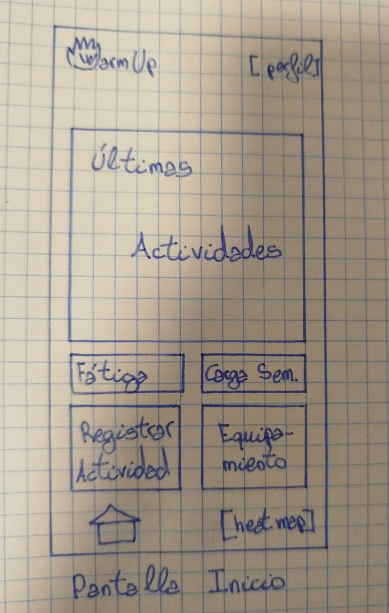
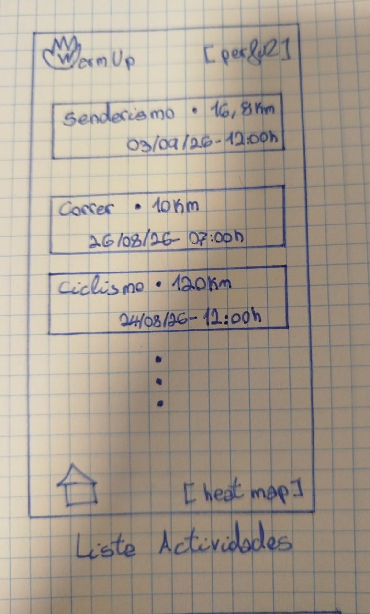
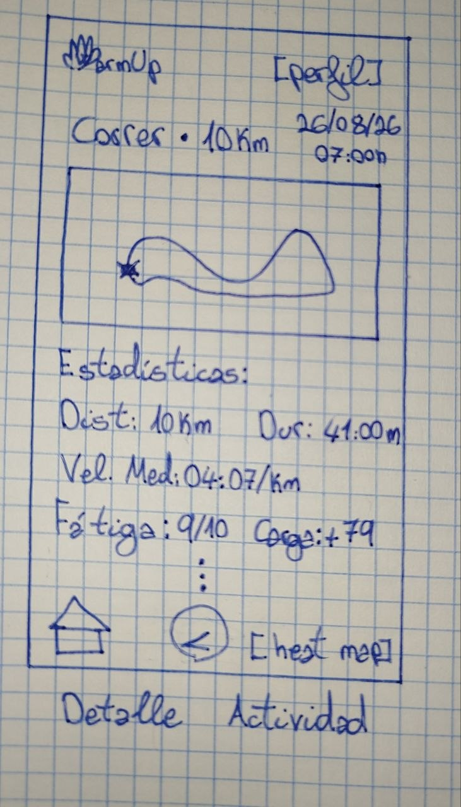
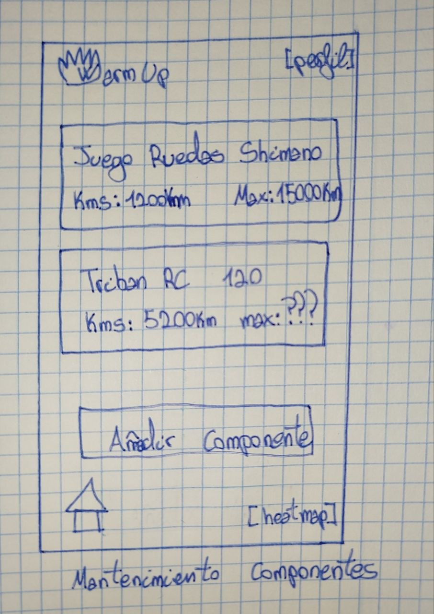

# Plantilla: propuesta del Proyecto A

---

## 0 · Datos

| |                          |
|---|--------------------------|
| **Nombre de la app** | WarmUp                   |
| **Autor/a** | Alexander Bello González |
| **Fecha** | 02/10/2026               |

---

## 1 · La idea en una frase

> Qué hace tu app y para quién, en una sola frase.
>
> Fórmula: «Una app que permite a [quién] hacer [qué] para [para qué].»

_WarmUp_ es una aplicación que **permite a los deportistas registrar** 
sus  actividades GPS, que evaluar su carga de entrenamiento acumulada y gestionar
el ciclo de vida de su equipamiento deportivo. El factor diferenciador de la
aplicación es la generación de un mapa de calor dinámico personalizado a
partir de los trazados GPS del usuario.

---

## 2 · El problema

> ¿Qué problema resuelve? ¿Cómo se resuelve hoy sin tu app?

Actualmente, los deportistas tienen que fragmentar estas funcionalidades: una
app generalista para guardar las rutas GPS, otra herramienta para calcular la
fátiga acumulada y excels para llevar constancia del desgaste del material. El
problema que resuelve _WarmUp_ es la integración y unificación de estas distintas
funcionalidades para un registro del rendimiento físico y un control del material
óptimo.

---

## 3 · Personas usuarias

> ¿Quién la va a usar? Describe a una persona concreta: edad, soltura con la
> tecnología, cuándo y dónde abre la app, cuánto tiempo le dedica y qué pasa
> si le falla.

**Deportistas** en general, con un enfoque en principal en **ciclistas** y
**corredores** de nivel amateur o más profesional en una franja de edad de 16 a
50 años principalmente, y una soltura tecnológica media.

Abre la aplicación al llegar a casa tras finalizar su entrenamiento al aire libre
para volcar sus datos GPS (si bien no es necesario que sea al aire libre), evalúa
los datos del entrenamiento y su carga de fátiga además de una rápida evaluación
del estado del material. Le dedica unos 5-15 minutos a este análisis posterior.

Si falla la app o pierde los datos de la sesión, el usuario se siente profundamente
frustrado porque esto interrumpe el seguimiento histórico de su rendimiento, así
como el control del mantenimiento del material, por lo que **necesita una
interfaz estable, rápida y fiable**.

---

## 4 · Funcionalidades

### Imprescindibles (sin esto la app no tiene sentido)

| # | Funcionalidad |
|---|---------------|
| F1     | **Registro GPS de rutas**: Captura y almacenamiento en tiempo real de las coordenadas geográficas, distancia, velocidad y tiempo durante la actividad al aire libre.     |
| F2     | **Cálculo de la carga y la fátiga**: Evaluación del esfuerzo acumulado del deportista a partir de los datos de las sesiones para así monitorizar su recuperación.        |
| F3     | **Control del equipamiento**: Gestión del ciclo de vida y desgaste de componentes o calzado según kilometraje acumulado.                                                 |

### Opcionales (si sobra tiempo)

| # | Funcionalidad |
|---|---------------|
| O1 | |
| O2 | |

---

## 5 · Pantallas

| Pantalla                          | Para qué sirve                                                                                             | Se llega desde         |
|-----------------------------------|------------------------------------------------------------------------------------------------------------|------------------------|
| **Pantalla de Inicio**            | Menú principal con acceso rápido al estado físico, a la grabación de actividad y al _feed_ de actividades. | (arranque)             |
| **_Feed_ de Actividades**         | Muestra el historial completo de las actividades con sus datos básicos.                                    | Pantalla de inicio     |
| **Ajustes del Equipamiento**      | Permite registrar nuevos componentes y supervisar el desgaste del equipamiento.                            | _Feed_ de actividades. |

---

## 6 · Bocetos

> Dibuja las pantallas principales. A mano y fotografiado es válido.
> Pega aquí las imágenes o indica el nombre de los archivos adjuntos.

- **Pantalla de Inicio**

- **Lista de Actividades**

- **Detalle Actividad**

- **Mantenimiento Componentes**

---

## 7 · Qué datos guarda la app

| Tipo de dato     | Campos                                               | Ejemplo                                                        |
|------------------|------------------------------------------------------|----------------------------------------------------------------|
| **Actividad**    | `id`, `fecha`, `distancia`,`duración`, `coordenadas` | `1`, `02/10/2026`, `21.2km`, `1h 28m`, `[[42.23, -8.72], ...]` |
| **Fátiga/Carga** | `id`, `fecha`, `esfuerzoPercibido`, `cargaAcumulada` | `1`, `02/10/2026`, `9/10`, `75.3`                              |
| **Equipamiento** | `id`, `nombreComponente`, `kmsActuales`, `límite`    | `1`, `Adidas Adizero Evo SL`, `423.4km`, `800km`               |

---

## 8 · Encaje con los requisitos del módulo

> Apartado obligatorio: ninguna casilla puede quedar vacía.

| Requisito                                                             | Dónde encaja en tu app                                                                                                                                   | Tema |
|-----------------------------------------------------------------------|----------------------------------------------------------------------------------------------------------------------------------------------------------|------|
| **Persistencia de datos** — la información sobrevive al cerrar la app | Se usará para guardar el histórico de rutas GPS, el cálculo de la fátiga acumulada y el estado del desgaste del equipamiento en una base de datos local. | 4    |
| **Servicio web** — la app consulta datos por internet                 | Se usará para consultar mapas en tiempo real y sincronizar datos metereológicos o de altimetría para las rutas.                                          | 5    |
| **Sensor o localización**                                             | Se emplea obligatoriamente para la captura de coordenadas mediante el GPS del dispositivo durante el entrenamiento.                                      | 6    |
| **Contenido multimedia** — foto, audio, vídeo o animación             | Se aplicará en la renderización y exportación dinámica de los mapas de calor personalizados y para gráficos de estadísticas de rendimiento               | 7    |

---

## 9 · Riesgos

| Lo que me preocupa                                                  | Plan B                                                                                                |
|---------------------------------------------------------------------|-------------------------------------------------------------------------------------------------------|
| **Consumo excesivo de batería y pérdida de señal GPS durante ruta** | Implementar un fuardado por lotes o importación manual de archivos _GPX_ si falla la geolocalización. |
| **Complejidad para el cálculo de la fátiga**                        | Limitarse en un inicio a estadísticas de kilometraje básico.                                          |

---

## Antes de entregar

- [X] La idea cabe en una frase.
- [X] El público es una persona concreta, no «todo el mundo».
- [X] Hay **3 o 4** funcionalidades imprescindibles, no diez.
- [X] Cada funcionalidad imprescindible tiene su pantalla.
- [X] Hay bocetos de las pantallas principales.
- [X] **Las cuatro casillas del apartado 8 están rellenas.**
- [X] Está identificado al menos un riesgo con su plan B.
